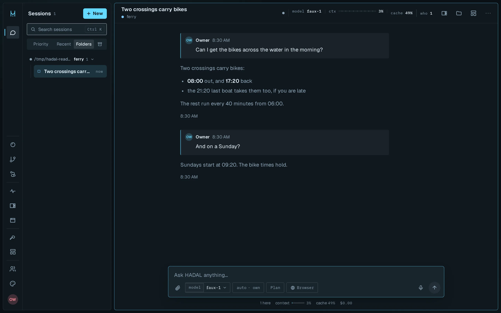
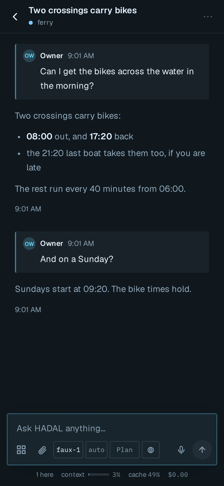

<p align="center">
    
</p>

<p align="center">
    <a href="https://nodejs.org"></a>
    <a href="LICENSE"></a>
    <a href="docs/features.md"></a>
    <a href="https://t-crypt.github.io/hadal/"></a>
</p>

<p align="center">
    <a href="#what-it-is">What it is</a> ·
    <a href="#what-it-does">What it does</a> ·
    <a href="#the-look">The look</a> ·
    <a href="#built-for-local-models">Built for local models</a> ·
    <a href="#measured">Measured</a> ·
    <a href="#quick-start">Quick start</a> ·
    <a href="#command-line">Command line</a> ·
    <a href="#roadmap">Roadmap</a>
</p>

---

## What it is

Most agent apps are tools you open, and they organise conversations. HADAL is a place you enter, and it
organises four things:

|                                                                                          |                                                                                                                 |
| ---------------------------------------------------------------------------------------- | --------------------------------------------------------------------------------------------------------------- |
| **Environments** A project folder with its sessions, files, branch, changes and lessons. | **Agents** Sessions at work, their subagents, roles, routers, and Lantern, the assistant that watches the rest. |
| **Capabilities** Models and engines, extensions, skills, hooks, memory and browser use.  | **Activity** What is running, what waits for your approval, schedules, spend and reports.                       |

It is tuned for self-hosted models: a small, stable prompt prefix, no surprise model swaps, requests that take turns
by model or endpoint, and context that is pruned before it is summarised. One card, several cards, or a rack of
engines reachable on your network all work through the same loop, and cloud providers use it too. Each change that
touches the prompt is measured on the same task, model and server before it stays.

<p align="center">
    
</p>
<p align="center"><sub>The desktop, mid-session, on the Bell look.</sub></p>

<p align="center">
    
</p>
<p align="center"><sub>The same session on a phone: push notifications, dictation, a home-screen app.</sub></p>

> [!NOTE]
> HADAL is early and changes quickly. The interface rebuild and the living harness under
> [Roadmap](#roadmap) are in progress; everything under [What it does](#what-it-does) works today.

## What it does

|                                                                                                                                                                                            |                                                                                                                                                                                                |
| ------------------------------------------------------------------------------------------------------------------------------------------------------------------------------------------ | ---------------------------------------------------------------------------------------------------------------------------------------------------------------------------------------------- |
| **Durable** Every model call, tool call and subagent is stored as it happens. Restart the server mid-run and the work continues.                                                           | **Multiplayer** Share a live session with presence, invites, roles, and a side chat the agent does not see.                                                                                    |
| **Made for phones** Push notifications, dictation, sharing from other apps, and a home-screen app.                                                                                         | **Lantern** An assistant that starts, follows and reports on your other sessions, and watches GitHub for you.                                                                                  |
| **Routers** A router checks each task and runs it through stages (plan, implement, review, fix, ship), each a fresh subagent on the model and effort you choose, built in a visual editor. | **SSH hosts** Run bash, read, write and edit on another machine from the same session.                                                                                                         |
| **Your models** Any provider, local or cloud, chosen per session with its thinking level.                                                                                                  | **Live-editable** No build step. The agent can change HADAL while it runs, and you can add your own extensions.                                                                                |
| **Guarded** Lancet Guard asks before risky commands; plan mode allows only calls marked read-only.                                                                                         | **Browser use** A per-session switch. When on, the agent asks before new sites, the local network, sign-ins, forms, purchases, deletions and scripts, as you set it. It never types passwords. |

The [feature tour](docs/features.md) covers the rest, from peek tiles to schedules and artifacts.

## The look

The default look is **Bell**: etched steel plates as depths that darken as they sink, near-square geometry,
monospaced figures and readouts, and cyan as the one signal light. It reads like control-room gear, not a chat app.
Every text token is measured against the rendered pixels (WCAG AA at all three depths), and signal is only ever a
mark of the living: nothing glows for decoration ([docs/design/hadal-ui.md](docs/design/hadal-ui.md)).

The look is a coat, not the structure. Appearance carries 24 palettes — Bell itself, the earlier blue depth kept as
**Zone**, and the Omarchy terminal themes — plus theme folders that restyle parts of the app without touching code
([docs/extensions/themes.md](docs/extensions/themes.md)), per-theme fonts, and one-tap duplication of any palette or
theme into your own. Switching any of it changes the paint while every layout, shortcut and behavior stays.

## Built for local models

Any OpenAI-compatible endpoint works, in any number: llama-swap or llama.cpp on one card, several engines on one
machine, or a few workstations on your network. HADAL queues requests per model, keeps a run on the engine that holds
its cache, and shows what is loading or waiting. Nothing assumes one GPU.

| Feature                       | What it does                                                                                                                                        |
| ----------------------------- | --------------------------------------------------------------------------------------------------------------------------------------------------- |
| Many sessions, any backend    | Requests take turns by model; a run keeps its engine between tool calls; the status line shows a model loading or waiting                           |
| Waiting subagents             | `subagent` with `wait: true` returns the answer as the call's result, so the parent writes nothing while a stage runs and the stage keeps its cache |
| Agent definitions             | `subagent` takes `agent: <name>` and loads that role's instructions, model, thinking level, tools and skills                                        |
| KV-prefix discipline          | The system prompt is byte-stable; the one line that changes by itself (the date) sits last, so a cache hit stays a hit all day                      |
| Prune before summarising      | Compaction first masks old tool output and drops stale re-reads and loops at no model cost; the summary runs only if that is not enough             |
| Read economy                  | A read without a limit returns at most 500 lines plus a map of what it skipped                                                                      |
| Loop guard                    | The third identical call in a turn is blocked; an edit re-arms it, so test, fix, test is not a loop. Slightly malformed call arguments are repaired |
| Tool search                   | Seldom-used tools load only when the agent searches for them                                                                                        |
| Per-role skills               | Each role sees its own skill list, not the whole catalogue                                                                                          |
| Context meter                 | `/context` splits the context into prompt sections, tool schemas and history; `/context baseline` compares before and after a change                |
| Titles on the session's model | No side model is loaded for a six-word title                                                                                                        |
| Lighter server                | In-process change counting and capped heap generations                                                                                              |

## Measured

Router start context, the tokens sent before the first word of every request (llama-swap `/api/metrics/activity`,
probe "Reply with just: ok", 2026-10-11): Pi Pocket with a router prompt 22,726; oh-my-pi 15,900; HADAL 13,226.

The same job (add `subtract(a, b)` with a pytest test: plan, implement, review, one model, one GPU), 2026-10-11:

| Harness                 | Wall  | Requests | Prompt tokens | Cached | Prefilled | Output | Result                 |
| ----------------------- | ----- | -------- | ------------- | ------ | --------- | ------ | ---------------------- |
| oh-my-pi                | 213 s | 41       | 685,014       | 81%    | 130K      | 20,009 | 2 passed, review clean |
| HADAL, before `wait`    | 187 s | 34       | 468,160       | 60%    | 186K      | 13,880 | 2 passed, review clean |
| HADAL, `wait`           | 179 s | 36       | 470,091       | 90%    | 47K       | 14,252 | 2 passed, review ship  |
| HADAL, all of the above | 145 s | 31       | 397,605       | 75%    | 99K       | 13,395 | 3 passed, review clean |

The last row is the median of three runs (136, 145 and 181 s). On a three-file repository most of these features
barely fire, so they mainly show that they cost nothing. Server spawn time on a copy of real data fell from 548 to
136 ms and RSS from 401 to 298 MB.

To measure a change yourself, run the same task before and after against the same server and read
`/api/metrics/activity` for prompt tokens, cache hits, output and wall time. A change stays only if it holds or
improves those numbers without lowering the result.

## Quick start

Requires Node.js 22.19 or newer. Runs on Linux, macOS and Windows; Linux is the most tested. Sign in to a provider
first with the terminal app (from the checkout, `npx pi`, then `/login`), or later from the app's Providers sheet.

```bash
git clone https://github.com/T-Crypt/hadal.git
cd hadal
npm install
npm start
```

The launcher asks how your devices should connect, then prints a sign-in link and a QR code. The link is the owner's
key: keep it private. `--rotate-token` replaces it and signs out every device that used it.

While it runs: **q** quit, **r** restart the server, **a** change access, **o** open in a browser, **s** show the QR
code.

To update a git checkout: stop the server, back up the data folder, pull, run `npm install`, and start again.

Also: Docker or Podman with `docker compose up -d --build` ([docs/docker.md](docs/docker.md)), and a systemd unit
([docs/systemd.md](docs/systemd.md)).

## Remote access

Choose a mode in the launcher, or pass `--access`:

| Mode              | Who can connect      | Notes                                                      |
| ----------------- | -------------------- | ---------------------------------------------------------- |
| `local`           | This machine         | `127.0.0.1`; bring your own tunnel                         |
| `lan`             | Your local network   | Plain http                                                 |
| `tailscale`       | Your tailnet         | Plain http on the tailnet address                          |
| `tailscale-serve` | Your tailnet         | https at the tailnet name; needs `tailscale` 1.52 or newer |
| `cloudflare`      | Anyone with the link | Free https quick tunnel; needs `cloudflared`               |

<details>
<summary><b>Other options and requirements</b></summary>

`tailscale-serve` needs `tailscale` on your `PATH`, signed in, with MagicDNS and HTTPS certificates enabled, and
your user set as tailscaled's operator when the launcher is not root (`sudo tailscale set --operator=$USER`).

Other options: `--port` (8787), `--cwd`, `--data`, `--host`, and `-y` to reuse the last access choice.
`npm start -- --help` lists them all. Environment variables use the `HADAL_` prefix; the older `PI_POCKET_` names
are still read. [docs/features.md](docs/features.md) lists each one.

</details>

> [!WARNING]
> Anyone who can steer a session can make the agent run commands on this machine, as you. That reaches your files,
> HADAL's own settings and tokens, and its code. Invite only people you would trust at your keyboard. View-only users
> cannot make the agent act. [SECURITY.md](SECURITY.md) says what is protected and what is not.

## Command line

The terminal is a client, not a second app. `hadal` is the server and its launcher; `hadal cli` is one tab in a
session, using the same database and the same tab protocol a browser does.

```bash
hadal serve                     # the launcher: pick how devices connect, then run the server
hadal cli                        # join the last session you used here, or start one
hadal cli --session 12           # join the session open in the browser at /s/12
hadal run -p "run the tests"     # send one message, wait for the run, exit 0, or 1 if it failed
```

`hadal cli` signs in with the owner token kept in the data folder, so on the server's machine there is nothing to set
up. With no server on the port it starts the launcher, waits until it answers, and stops it on exit unless you pass
`--leave`. It holds neither lock, so it can run beside `hadal serve` and a browser, all on one server.

The run lives on the server. Ctrl+C detaches and prints the command to come back with; closing the terminal does not
stop the work, and a server restart does not lose it, because the CLI reconnects to the stream and the reattached view
brings everything it missed. A session the CLI made carries a `terminal` chip in the browser's session list, and the
same session opens at `/s/<id>`.

The transcript draws as it arrives: the answer as it is written, each tool call on one line with its result, a failed
run in red, and approvals with a `y` or `n` answer. `/stop` stops the run, `/open` prints the browser address, and
`/exit` detaches. `--list`, `--new`, `--thinking`, `--verbose`, `--no-start` and `hadal cli --help` cover the rest.

## Roadmap

The plan for the next year is in [docs/ROADMAP.md](docs/ROADMAP.md): a harness that sits closer to the model, a code
dashboard for usage and commits, multi-machine setups, and the interface shell on the Bell tokens.

- **Durable by default.** Every run, tool call and subagent is recorded as it happens, by the server, for every client.
- **Closer to the model.** One prefix that stays byte-stable, context pruned before it is summarised, and profiles per
  model architecture, starting with the Qwen family.
- **Many machines.** Several engines and workstations behind one server, each request to the engine that can serve it.
- **A profile that earns its rail slot.** Commits, token usage and averages for the week, month and year, next to the
  sessions and settings a person already has.

## Development

```bash
npm run check       # type-check
npm test            # server tests with a scripted model
npm run check:web   # type-check web/
npm run coverage    # tests with line coverage, held at 60%
npm run format      # ESLint layout fixes, then Prettier
npm run lint        # check the layout rules
npm run shots       # regenerate the README's two previews (needs a Chromium and playwright-core)
```

`web/` changes reload every open browser, and extensions reload into the running server. `node test/serve.ts` runs a
throwaway copy to test a change on. [AGENTS.md](AGENTS.md) covers editing HADAL safely from inside itself,
[docs/extensions.md](docs/extensions.md) the extension host, and [CONTRIBUTING.md](CONTRIBUTING.md) how to send a
change.

## Limitations

- HADAL runs on Pi Durable, which is experimental; its API can change between releases. Versions are pinned in
  `package.json`.
- Only one server process can use the database at a time.
- HADAL's own extensions are not supported. HADAL runs its own.
- A git worktree keeps a session's files apart; it is not a sandbox.
- The built-in browser needs Chromium, Chrome, Brave or Edge on the server.

## Origins

HADAL began as a fork of [Pi Pocket](https://github.com/TannerMidd/pi-pocket) by Tanner Middleton and broke away at
Pi Pocket 0.28.2. It runs agents on [Pi Durable](https://earendil.com/posts/pi-durable/) and the model runtime from
Earendil, and several context features were ported from [oh-my-pi](https://github.com/can1357/oh-my-pi). HADAL is
independent and not affiliated with either project.

## Support

If HADAL is useful to you, you can support its work on [Ko-fi](https://ko-fi.com/tcrypt).

## License

[MIT](LICENSE), keeping the original Pi Pocket notice. Bundled fonts keep their own licenses, beside them in
[web/fonts/](web/fonts/). One dependency is not MIT: HEIC photos are decoded with
[libheif-js](https://github.com/catdad-experiments/libheif-js) (LGPL-3.0), an ordinary npm package you can replace.
To report a security problem, see [SECURITY.md](SECURITY.md).
